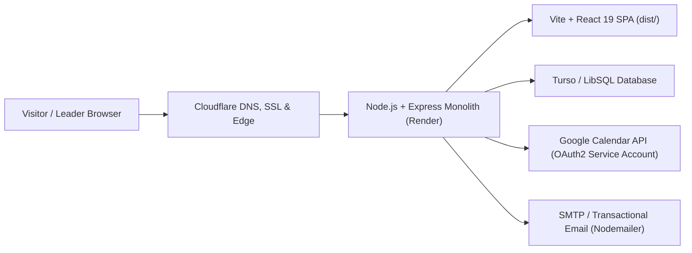

# Gewest Reinaertland — Regional Portal & Management Platform

[](https://reinaertland.be)
[](https://react.dev)
[](https://www.typescriptlang.org)
[](https://expressjs.com)
[](https://tailwindcss.com)
[](https://turso.tech)

A full-stack web application and internal operations dashboard built for **Gewest Reinaertland** — the regional Chiro youth-movement umbrella supporting 9 local Chiro groups across Stekene, Sinaai, Kemzeke, Meerdonk, Verrebroek, and De Klinge (Belgium).

The platform combines a fast, public-facing regional website with a role-based management portal covering **event scheduling with two-way Google Calendar sync**, **dynamic registration forms with SEPA/Payconiq QR payment flows**, **treasury & financial reporting**, **leader directory management**, and **photo album curation**.

---

## Key Features

### Public Website
- **Landing Page & Regional Overview:** Responsive public showcase of upcoming regional activities, affiliated Chiro groups, recent photo albums, and a rate-limited contact form.
- **Live Regional Agenda (`/agenda`):** Upcoming events automatically filtered by date, with one-click export to **Google Calendar** and **RFC 5545 `.ics` files** (Apple Calendar / Outlook).
- **Dynamic Registration Forms (`/inschrijvingen`):** Public event sign-up forms with real-time validation, optional duplicate-submission prevention, automated HTML confirmation emails, and instant **EPC/SEPA payment QR codes** for paid activities.
- **Photo Gallery (`/fotos`):** Filterable timeline of regional photo albums organized by year and category, linking out to external album hosts (Google Photos, Flickr, Dropbox).

### Protected Management Dashboard (`/beheer/*`)
- **Executive Dashboard:** Live summary of upcoming meetings, regional leadership directory, and current-year (`werkjaar`) treasury status.
- **Treasury & Financial Management (`/beheer/financien`):**
  - Bank balance tracking and per-event income/expense ledgers grouped by Chiro working year (`1 Oct – 30 Sep`).
  - Automatic revenue import from paid registration forms (separating members, leaders, and beverage contributions).
  - Print-ready annual & per-event financial reports and high-resolution PNG exports (`html2canvas-pro`).
- **Dynamic Form Builder & Registration Manager (`/beheer/formulieren`):**
  - Drag-free custom form builder with reusable Chiro activity templates (e.g., *IKAA*, *Gewestweekend*, *Cocktailquiz*).
  - Payment tracking per participant, 1-click bulk payment reminder emails for unpaid registrations, CSV export (with formula-injection protection), and formatted vector PDF / printable attendance sheets (`jsPDF` + `jspdf-autotable`).
- **Two-Way Google Calendar Sync (`/beheer/agenda`):**
  - Service-account OAuth2 JWT integration synchronizing events bi-directionally between the website database and Google Calendar with smart duplicate matching.
- **Unified Leadership & Role Management (`/beheer/leiding`):**
  - Multi-role RBAC (`admin`, `groepsleiding`, `website`, `penningmeester`, `media`, `som`, `veegee`, `twizzit`, `leiding`).
  - Bulk CSV import/export with cryptographically generated one-time temporary passwords and forced first-login password reset.
  - Exclusive single-Admin ownership with dedicated Admin transfer workflow.
- **Photo Album Manager (`/beheer/albums`):**
  - Manage external album links and cover images with **automatic client-side HTML5 Canvas WebP compression** (resizing and compressing uploaded photos in-browser to `< 60 KB` WebP to minimize server bandwidth).
- **Contact Inbox & Personal Preferences (`/beheer/berichten`, `/beheer/profile`):**
  - Message management, profile editing, password rotation, persistent dark-mode preference synced to the database, and automatic 2-hour inactivity logout.

---

## Architecture



In development, Express attaches Vite in middleware mode for instant HMR. In production, Express serves the pre-built Vite bundle from `dist/` with tuned `Cache-Control` headers (`immutable` for hashed assets, `no-store` for API endpoints) alongside the `/api/*` REST backend.

---

## Security Architecture

This application was audited and hardened end-to-end against common web vulnerabilities (OWASP Top 10):

- **Authentication & Instant Session Revocation:** Signed `HS256` JWTs stored in `HttpOnly`, `Secure`, `SameSite=Strict` cookies with sliding inactivity expiration and database-backed `tokenVersion` checks. Logging out, changing passwords, updating roles, or disabling an account immediately invalidates existing sessions server-side.
- **Strict Role-Based Access Control (RBAC):** Fresh roles are loaded from the database on every request. Forced first-login password resets (`mustChangePassword`) are enforced server-side, and sensitive operations (such as assigning or transferring the `admin` role) are strictly isolated to the active Admin.
- **Timing-Attack & Brute-Force Protection:** `bcrypt` password hashing (12 rounds) with constant-time dummy hash verification on unknown emails, plus tiered `express-rate-limit` rules on login, password changes, public forms, bulk emails, and calendar sync.
- **XSS, Injection & CSRF Defenses:**
  - Production **Content Security Policy** (`Helmet`) with `script-src 'self'` (no `'unsafe-inline'`), HSTS preload, and `X-Powered-By` disabled.
  - Production **CSRF Origin/Referer validation** on all state-changing `/api/*` requests.
  - Parameterized SQL queries across all LibSQL statements.
  - Strict URL & image protocol validation on both backend and frontend (`safeHref`, `safeImageUrl`, `safeCssUrl`) blocking `javascript:`, `data:image/svg+xml`, and CSS injection.
  - Full HTML escaping in all outgoing transactional emails and isolated print views, plus CSV/DDE formula-injection neutralization on all CSV exports.

---

## Tech Stack

| Layer | Technologies |
| :--- | :--- |
| **Frontend** | React 19, TypeScript, React Router 7, Tailwind CSS 4, Motion (Framer Motion), Lucide Icons, Material Symbols |
| **Backend** | Node.js, Express 4, TypeScript (`tsx`), Helmet, CORS, Express Rate Limit, Nodemailer, Validator |
| **Database** | LibSQL / Turso (`@libsql/client`) |
| **Auth & Crypto** | JSON Web Tokens (`jsonwebtoken`), `bcrypt` (v6), Node `crypto` |
| **Exports & Utilities** | `jsPDF`, `jspdf-autotable`, `html2canvas-pro`, `qrcode.react` |
| **Integrations & Infra** | Google Calendar REST API v3 (OAuth2 RS256 Service Account), Render, Cloudflare |

---

## Project Structure

```text
├── server.ts                  # Express backend, REST API, auth/RBAC, DB init, SMTP & static serving
├── googleCalendar.ts          # Two-way Google Calendar API v3 client (OAuth2 JWT service account)
├── index.html                 # Vite HTML entry point & Open Graph metadata
├── vite.config.ts             # Vite + React + Tailwind CSS 4 build configuration
├── public/                    # Static public assets (WebP/PNG images, favicon, robots.txt, sitemap.xml)
└── src/
    ├── App.tsx                # Router, DashboardLayout, session sync, Agenda, Messages & Profile views
    ├── Albums.tsx             # Album management dashboard with client-side WebP compression
    ├── components/            # Reusable modals & widgets (AddToCalendar, PasswordReset, Reporting, etc.)
    ├── pages/                 # Standalone views (Landing, Agenda, Fotos, Inschrijvingen, Financien,
    │                          #   BeheerFormulieren, LeidingBeheer, Login)
    ├── types/                 # Shared TypeScript interfaces
    └── utils/                 # Date parsing, .ics generator, PDF/PNG exporters, form templates & safeUrl
```

---

## Getting Started

### Prerequisites

- **Node.js** v18 or higher (v20+ recommended)
- A **Turso / LibSQL** database (or local SQLite `file:./local.db` for local testing)

### Installation

```bash
git clone https://github.com/LouisLoquet/Gewest-Reinaertland-Portal.git
cd Gewest-Reinaertland-Portal
npm install
```

### Environment Configuration

Copy `.env.example` to `.env` and fill in your credentials:

```bash
cp .env.example .env
```

| Variable | Required | Description |
| :--- | :---: | :--- |
| `TURSO_DATABASE_URL` | Yes | LibSQL/Turso connection URL (or `file:./local.db` locally) |
| `TURSO_AUTH_TOKEN` | Yes* | Turso authentication token (*required for remote Turso DBs) |
| `JWT_SECRET` | Yes (Prod) | Random secret string (minimum 32 characters; 64+ recommended) |
| `ALLOWED_ORIGIN` | Yes (Prod) | Production origin URL (e.g. `https://reinaertland.be`) |
| `PORT` | No | Server listening port (default: `3000`) |
| `SESSION_INACTIVITY_HOURS` | No | Sliding session timeout in hours (default: `2`) |
| `DEFAULT_ADMIN_EMAIL` | No | Email for the initial admin seeded on an empty database |
| `DEFAULT_ADMIN_NAME` | No | Display name for the initial seeded admin |
| `DEFAULT_ADMIN_PASSWORD` | No | Initial admin password (if omitted, a strong random password is generated and printed once on startup) |
| `GOOGLE_CALENDAR_ID` | No | Target Google Calendar ID for two-way agenda sync |
| `GOOGLE_SERVICE_ACCOUNT_EMAIL` | No | GCP Service Account email with Calendar write access |
| `GOOGLE_SERVICE_ACCOUNT_KEY_JSON` | No | Full JSON content of the GCP Service Account key |
| `GOOGLE_API_KEY` | No | Optional Google Calendar API key for public read access |
| `SMTP_HOST`, `SMTP_PORT`, `SMTP_USER`, `SMTP_PASS`, `SMTP_FROM` | No | SMTP settings for confirmation and payment reminder emails |

### Available Scripts

| Command | Description |
| :--- | :--- |
| `npm run dev` | Starts Express + Vite HMR development server on `http://localhost:3000` |
| `npm run build` | Builds the optimized production frontend bundle into `dist/` |
| `npm start` | Runs the production Express server (`NODE_ENV=production`) serving `dist/` and `/api/*` |
| `npm run lint` | Runs TypeScript static type checking (`tsc --noEmit`) |
| `npm run clean` | Removes the `dist/` build directory |

---

## Deployment

The platform is designed for low-cost/free-tier cloud deployment:

1. **Database:** Create a free LibSQL database on [Turso](https://turso.tech).
2. **Application Server:** Deploy as a Node.js Web Service on [Render](https://render.com) (or any VPS/Docker host):
   - **Build Command:** `npm install && npm run build`
   - **Start Command:** `npm start`
   - Configure all required environment variables in the Render dashboard.
3. **DNS & TLS:** Point your custom domain through [Cloudflare](https://cloudflare.com) with **Proxied** DNS records and SSL/TLS set to **Full (strict)**.

---

## Author

Built and maintained by **Louis Loquet** for **Gewest Reinaertland** (Chirojeugd Vlaanderen).
